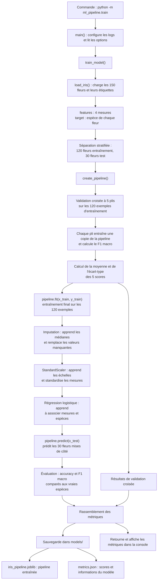
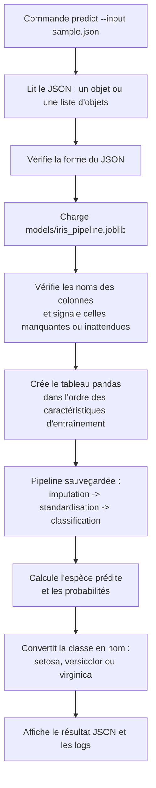
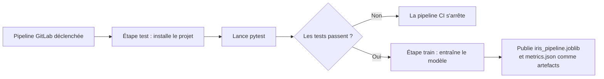

# TP1 - Classic ML Pipeline End-to-End

Ce TP construit un parcours complet de classification avec le jeu de données Iris fourni par scikit-learn. Le modèle prédit une espèce (`setosa`, `versicolor` ou `virginica`) à partir de quatre mesures de sépales et pétales.

## Contenu

- `src/ml_pipeline/pipeline.py` : imputation, standardisation et régression logistique dans une pipeline scikit-learn.
- `src/ml_pipeline/train.py` : séparation stratifiée train/test, validation croisée, métriques et sauvegarde des artefacts.
- `src/ml_pipeline/predict.py` : prédiction à partir d'un fichier JSON.
- `tests/` : tests de l'entraînement et de l'inférence.
- `.gitlab-ci.yml` : exécution des tests puis entraînement automatique et conservation des artefacts.

## Bibliothèques utilisées

- **scikit-learn** (`sklearn`) : charge le jeu Iris, construit le prétraitement et le classifieur, sépare les données, effectue la validation croisée et calcule les métriques.
- **pandas** : représente les mesures sous forme de tableau nommé, utile pour respecter les colonnes attendues par le modèle.
- **joblib** : enregistre et recharge la pipeline entraînée dans `models/iris_pipeline.joblib`.
- **pytest** : exécute les tests automatisés ; `tmp_path` fournit des dossiers temporaires isolés aux tests.
- **Bibliothèque standard Python** (`argparse`, `json`, `logging`, `pathlib`) : lit les arguments de commande, manipule le JSON, affiche les logs et construit les chemins de fichiers. Elle ne s'installe pas avec pip.

## Parcours des données

Le jeu Iris contient 150 fleurs décrites par quatre mesures et leur espèce. Il est fourni avec scikit-learn et chargé en mémoire par `load_iris()` ; le projet ne télécharge ni ne sauvegarde un fichier de données d'entraînement.

### Entraînement

Lancer `python -m ml_pipeline.train` appelle `main()`, qui lit les options, puis `train_model()`. Le code réserve 20 % des données au test et conserve les proportions des espèces grâce à la séparation stratifiée.



La validation croisée n'utilise que les données d'entraînement. Les paramètres de prétraitement sont donc appris sans consulter le jeu de test, qui sert à l'évaluation finale.

La pipeline scikit-learn applique ses étapes dans cet ordre : imputation, standardisation, puis régression logistique. L'entraînement produit `models/iris_pipeline.joblib`, qui contient le prétraitement et le modèle, et `models/metrics.json`, qui contient les métriques. Les données Iris elles-mêmes ne sont pas enregistrées.

## Installation (Windows PowerShell)

Depuis la racine du projet :

```powershell
py -3.11 -m venv .venv
.\.venv\Scripts\Activate.ps1
python -m pip install --upgrade pip
python -m pip install -e ".[dev]"
```

Si PowerShell bloque l'activation de l'environnement, exécute les commandes d'installation avec `\.venv\Scripts\python.exe` à la place de `python`.

## Exécuter le TP

Lancer les tests :

```powershell
python -m pytest
```

Entraîner et évaluer le modèle :

```powershell
python -m ml_pipeline.train
```

Le programme crée `models/iris_pipeline.joblib` et `models/metrics.json`. Les métriques comprennent l'accuracy et le F1 macro sur le jeu de test, ainsi que le F1 macro moyen de la validation croisée. Le jeu de test est gardé à part de l'entraînement et de la validation croisée.

## Faire une prédiction

Créer `sample.json` avec une mesure par caractéristique :

```json
{
  "sepal length (cm)": 5.1,
  "sepal width (cm)": 3.5,
  "petal length (cm)": 1.4,
  "petal width (cm)": 0.2
}
```

Puis lancer :

```powershell
python -m ml_pipeline.predict --model models/iris_pipeline.joblib --input sample.json
```

Le fichier peut contenir un objet JSON pour une fleur ou une liste d'objets. Le programme vérifie que chaque objet possède exactement les caractéristiques attendues, puis la pipeline sauvegardée applique le même prétraitement qu'à l'entraînement avant la classification.



La sortie contient l'espèce prédite et la probabilité maximale renvoyée par le classifieur. Ce score n'est pas une garantie que la prédiction est certaine.

## Automatisation GitLab CI/CD

À chaque pipeline GitLab, le job `tests` installe le projet et exécute les tests. Si ceux-ci passent, le job `train-model` entraîne le modèle ; le modèle sérialisé et les métriques sont disponibles comme artefacts du job pendant une semaine. Cette automatisation CI/CD orchestre le projet ; la pipeline scikit-learn, elle, enchaîne le prétraitement et le classifieur pendant l'entraînement et l'inférence.



En résumé, la pipeline scikit-learn prépare les données et fait les prédictions. La pipeline GitLab CI/CD automatise les tests et l'entraînement du projet.
